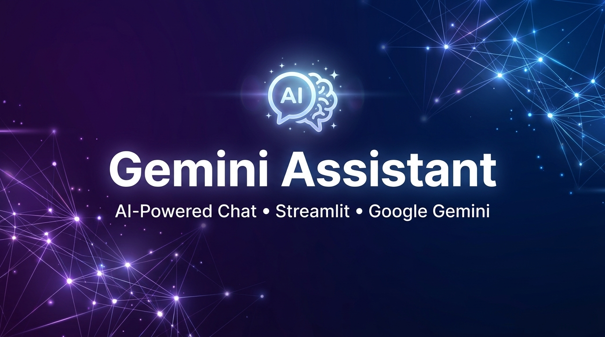
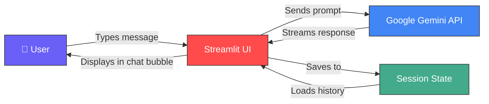

<p align="center">
  
</p>

<h1 align="center">🌈 Gemini Assistant</h1>

<p align="center">
  <strong>A smart, Gemini-powered AI chat assistant that helps you answer questions, solve problems, write content, learn new concepts, and get things done faster.</strong>
</p>

<p align="center">
  <a href="https://www.python.org/downloads/"></a>
  <a href="https://streamlit.io/"></a>
  <a href="https://ai.google.dev/"></a>
  <a href="https://github.com/shinkarvivek1015-oss/Gemini-Assisant"></a>
  <a href="https://github.com/shinkarvivek1015-oss/Gemini-Assisant"></a>
</p>

<p align="center">
  <a href="#-features">Features</a> •
  <a href="#-demo">Demo</a> •
  <a href="#-project-structure">Structure</a> •
  <a href="#-getting-started">Getting Started</a> •
  <a href="#-usage">Usage</a> •
  <a href="#-tech-stack">Tech Stack</a> •
  <a href="#-contributing">Contributing</a>
</p>

---

## ✨ Features

| Feature | Description |
|---------|-------------|
| 🤖 **Gemini AI Integration** | Powered by Google's latest Gemini Flash model for fast, intelligent responses |
| 💬 **Real-Time Streaming** | Responses stream progressively with a live typing cursor for a smooth experience |
| 🎨 **Beautiful UI** | Colorful gradient backgrounds, glassmorphism effects, custom chat bubbles & avatars |
| 📜 **Chat History** | Full conversation history maintained during each session |
| ⚙️ **Customizable Settings** | Adjust model selection, creativity (temperature), and system instructions via sidebar |
| 🆕 **New Chat** | Clear the conversation and start fresh with a single click |
| 🔒 **Secure API Key** | API key loaded securely from `.env` environment variables |
| 📱 **Responsive Design** | Centered layout with custom scrollbar and responsive sidebar |
| ✍️ **Custom System Prompts** | Guide the AI's behavior with optional system instructions |
| 🌀 **Smooth Animations** | Fade-in animations on chat messages, hover effects on buttons, and a rainbow-shifting header |

---

## 🎬 Demo

<p align="center">
  
</p>

**What the chat interface looks like:**

```
┌─────────────────────────────────────────────────────────────┐
│                    🌈  Gemini Assistant                     │
│                     Ask me anything ✨                      │
├─────────────────────────────────────────────────────────────┤
│                                                             │
│                       🧑  What is quantum computing?        │
│                                                             │
│  ✨  Quantum computing is a type of computation that        │
│      harnesses quantum mechanical phenomena such as         │
│      superposition and entanglement to process              │
│      information in fundamentally new ways...               │
│                                                             │
├─────────────────────────────────────────────────────────────┤
│  💬  Message Gemini...                                      │
└─────────────────────────────────────────────────────────────┘
```

---

## 📁 Project Structure

The project contains **three evolutionary versions** of the chatbot, each building on the previous:

```
Gemini-Assistant/
│
├── 📄 chat.py          # v1 — Basic Q&A chatbot (foundation)
├── 📄 hat.py           # v2 — Enhanced UI with custom CSS & dark theme
├── 📄 qachat.py        # v3 — Full-featured assistant (recommended ⭐)
├── 📄 .env             # API key configuration (not tracked in git)
├── 📁 assets/          # Project assets (banner image, etc.)
│   └── 🖼️ banner.jpg   # README banner image
└── 📄 README.md        # You are here!
```

### 📝 File Breakdown

#### `chat.py` — The Foundation
> A minimal, functional Q&A chatbot to get started quickly.

- ✅ Basic Streamlit text input + button interface
- ✅ Sends questions to Gemini and displays streamed responses
- ✅ Maintains simple chat history with role labels

#### `hat.py` — Enhanced Experience
> Adds a polished dark-mode UI with custom CSS styling.

- ✅ **Dark gradient background** (purple → deep violet)
- ✅ **Custom chat bubbles** — gradient-colored user & glass-effect bot messages
- ✅ **Avatar icons** for user (🧑) and bot (🤖)
- ✅ Responsive two-column input layout with a "Send 🚀" button
- ✅ Smooth box-shadow and hover effects on buttons

#### `qachat.py` — The Complete Assistant ⭐
> The production-ready version with all bells and whistles.

- ✅ **Rainbow gradient background** with Poppins font
- ✅ **Sidebar settings panel** with:
  - Model selection dropdown
  - Temperature/creativity slider (0.0 → 1.0)
  - Custom system instruction text area
  - "New Chat" button to reset the conversation
- ✅ **Streamlit `st.chat_message`** — native chat UI components
- ✅ **`st.chat_input`** — sticky bottom input bar with Enter-to-send
- ✅ **Real-time streaming** with a live `▌` typing cursor
- ✅ **Error handling** — gracefully catches API errors
- ✅ **Dynamic model reconfiguration** — changes take effect instantly
- ✅ **Rainbow-animated header** with CSS `@keyframes`
- ✅ **Custom scrollbar** with gradient styling

---

## 🚀 Getting Started

### Prerequisites

- **Python 3.9+** installed on your machine
- A **Google Gemini API key** (get one free at [Google AI Studio](https://aistudio.google.com/apikey))

### Installation

**1. Clone the repository**

```bash
git clone https://github.com/shinkarvivek1015-oss/Gemini-Assisant.git
cd Gemini-Assisant
```

**2. Create a virtual environment (recommended)**

```bash
python -m venv venv

# Windows
venv\Scripts\activate

# macOS / Linux
source venv/bin/activate
```

**3. Install dependencies**

```bash
pip install streamlit google-generativeai python-dotenv
```

**4. Configure your API key**

Create a `.env` file in the project root:

```env
GOOGLE_API_KEY="your-google-gemini-api-key-here"
```

> ⚠️ **Never commit your `.env` file!** Add it to `.gitignore` to keep your API key safe.

**5. Run the application**

```bash
# Run the full-featured version (recommended)
streamlit run qachat.py

# Or try the other versions
streamlit run hat.py
streamlit run chat.py
```

The app will open automatically in your browser at `http://localhost:8501` 🎉

---

## 💡 Usage

### Basic Chatting
Simply type your question in the input bar at the bottom and press **Enter**. The AI will respond with a streaming, real-time answer.

### Adjusting Settings (qachat.py)
Open the **sidebar** (click `>` on the top-left) to:

| Setting | What It Does |
|---------|-------------|
| **Model** | Choose which Gemini model to use |
| **Temperature** | `0.0` = focused & deterministic, `1.0` = creative & varied |
| **System Instruction** | Set a persona or behavior guide (e.g., *"Be concise and professional"*) |
| **New Chat** | Clears all history and starts a fresh conversation |

### Example Prompts
```
💡 "Explain machine learning like I'm 5"
📝 "Write a professional email to reschedule a meeting"
💻 "Debug this Python code: [paste code]"
🎯 "Create a study plan for learning React in 30 days"
🧮 "Solve this equation step by step: 3x² + 5x - 2 = 0"
```

---

## 🛠️ Tech Stack

<p align="center">

| Technology | Purpose |
|-----------|---------|
|  | Core programming language |
|  | Web application framework & UI |
|  | AI model API for intelligent responses |
|  | Secure environment variable management |
|  | Custom styling, gradients & animations |

</p>

---

## 🏗️ Architecture



---

## 🔧 Configuration

| Environment Variable | Required | Description |
|---------------------|----------|-------------|
| `GOOGLE_API_KEY` | ✅ Yes | Your Google Gemini API key from [AI Studio](https://aistudio.google.com/apikey) |

### Model Parameters (adjustable in sidebar)

| Parameter | Default | Range | Description |
|-----------|---------|-------|-------------|
| `temperature` | `0.7` | `0.0 – 1.0` | Controls randomness. Lower = more focused, higher = more creative |
| `system_instruction` | *empty* | Free text | Optional persona/behavior instructions for the AI |

---

## 🤝 Contributing

Contributions are welcome! Here's how you can help:

1. **Fork** the repository
2. **Create** a feature branch (`git checkout -b feature/amazing-feature`)
3. **Commit** your changes (`git commit -m 'Add amazing feature'`)
4. **Push** to the branch (`git push origin feature/amazing-feature`)
5. **Open** a Pull Request

### Ideas for Contributions
- 🖼️ Add image/file upload support
- 💾 Save/load conversation history to file
- 🌙 Add dark/light theme toggle
- 📊 Add token usage statistics
- 🔗 Multi-turn context management improvements

---

## 📜 License

This project is open source and available under the [MIT License](LICENSE).

---

## 👨‍💻 Author

<p align="center">
  <a href="https://github.com/shinkarvivek1015-oss">
    
  </a>
</p>

---

<p align="center">
  <strong>⭐ If you found this project helpful, please give it a star!</strong>
</p>

<p align="center">
  Made with ❤️ and powered by Google Gemini
</p>
